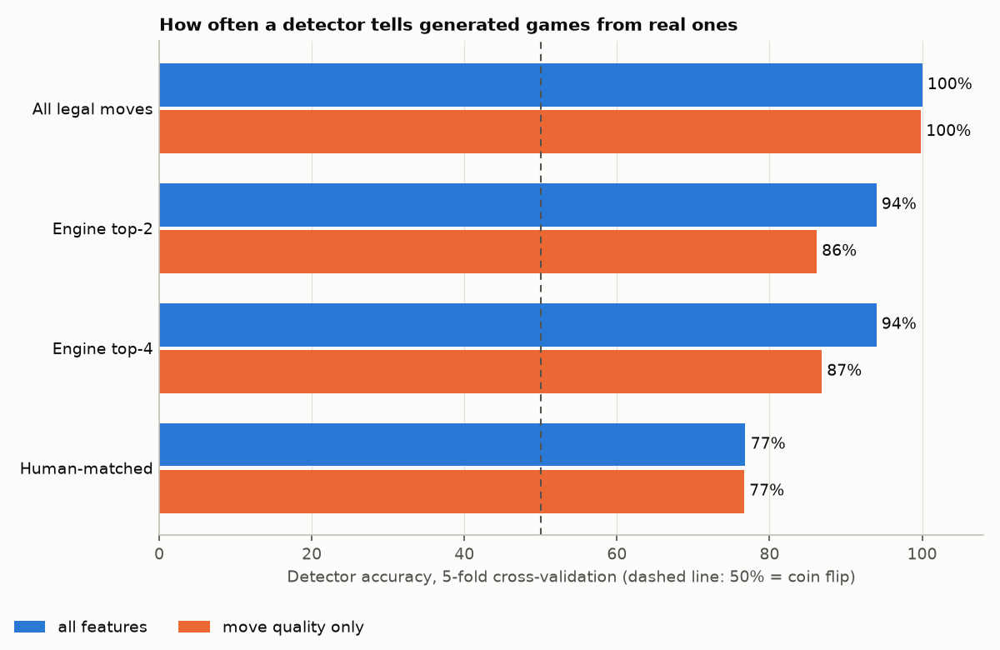

# Chess Stego, explained from scratch

This is the full write-up of the project, written for someone who has never
studied cryptography or steganography. Read it top to bottom once; after that
the code should feel familiar.

---

## 1. What we built

A command-line tool that hides any file inside chess games. The file is first
locked with a password using strong, standard encryption (AES-256-GCM). The
locked bytes are then turned into chess moves and saved as an ordinary PGN file
(the text format every chess program reads). Someone with the PGN file, the
password and the same settings gets the original file back, byte for byte.

We then asked the uncomfortable question: *would anyone notice?* We compared
the generated games with 300 real human games from Lichess and trained a
detector to tell them apart.

---

## 2. Key concepts, explained simply

### Encoding vs encryption vs steganography

These three are easy to mix up.

| | What it does | Everyday picture | Secret needed to undo it? |
|---|---|---|---|
| **Encoding** | Writes the same information in a different form | Translating a sentence into Morse code | No. Anyone who knows the rules can reverse it |
| **Encryption** | Scrambles information so only the key holder can read it | Putting a letter in a locked safe | Yes, the key |
| **Steganography** | Hides the *fact* that there is a message at all | Writing in invisible ink between the lines of a boring letter | Not necessarily. Its goal is to avoid being noticed |

Turning bytes into chess moves is only an **encoding**. If that were all we
did, anyone who guessed the trick could read the message. So this project does
two separate things:

1. **Encrypt** the file. This is what keeps the content secret.
2. **Encode** the encrypted bytes as chess games. This is the steganography
   part: it tries to make the message not look like a message.

A locked safe sitting in the middle of the room keeps its contents secret, but
everyone can see there is a safe. Steganography is hiding the safe behind a
painting. We do both, and (as section 5 shows) our painting is not perfect.

### AES-GCM: the lock, with a tamper seal

**AES** is the standard encryption algorithm used practically everywhere
(HTTPS, phone storage, Wi-Fi). "256" is the key size in bits. The number of possible
256-bit keys has 78 digits, so trying them all is not an option, even with
every computer on Earth.

**GCM** is the *mode*: the recipe for using AES on a message of any length. It
adds one very useful extra, a 16-byte **authentication tag**. Think of a wax
seal on an envelope:

- When encrypting, GCM computes the tag from the key and every byte of the
  scrambled message.
- When decrypting, it recomputes the tag and compares. If the password is wrong,
  or if even one bit of the data was changed, the tags do not match and
  decryption **refuses** instead of handing back garbage.

That is why changing a single chess move in the PGN makes decoding fail
cleanly: a different move means a different number, which means different
bytes, which breaks the seal.

GCM also needs a **nonce** ("number used once"): 12 random bytes that make sure
encrypting the same file twice gives completely different output. It is not
secret and is stored next to the ciphertext.

### scrypt: turning a password into a key

AES needs a key of exactly 32 random-looking bytes. People have passwords like
`hunter2`. A **key derivation function** bridges the gap, and **scrypt** is one
designed for passwords. It has two jobs:

- **Be slow on purpose.** One run takes roughly a tenth of a second and about
  32 MB of memory. You do not notice that once. An attacker trying a billion
  passwords notices it very much: it turns a weekend of guessing into
  centuries. The memory requirement makes special password-cracking hardware
  far less useful.
- **Use a salt.** A salt is 16 random bytes mixed into the calculation and
  stored with the output. The same password with a different salt gives a
  completely different key, so attackers cannot prepare one giant table of
  "password -> key" in advance and reuse it against everyone.

So the encrypted blob looks like this:

```
salt (16 bytes) | nonce (12 bytes) | scrambled data + tag (16 bytes)
```

Hiding an empty file therefore still produces 44 bytes.

### Mixed-radix encoding: the core trick

Any file is just a list of bytes, and a list of bytes can be read as one
enormous whole number. So the question becomes: **how do you write a big number
as a sequence of chess moves?**

Think about how ordinary numbers work. In base 10 every digit has 10 choices.
The clock uses a *mixed* base: 60 seconds per minute, 60 minutes per hour, 24
hours per day. "2 days, 3 hours, 15 minutes" is one number written with digits
whose bases differ.

A chess game is the same idea. If a position has 20 legal moves, the move
played there is a digit in base 20. If the next position has 30 legal moves,
that move is a digit in base 30. We sort the moves in an agreed order (say,
alphabetically), and "play move number 7" means "this digit is 7".

**Worked example: hide the number 100** in positions that have 20, 30 and 25
legal moves.

| Position | Legal moves (the base) | Calculation | Move played | Number left |
|---|---|---|---|---|
| 1 | 20 | 100 / 20 = 5 remainder **0** | move #0 | 5 |
| 2 | 30 | 5 / 30 = 0 remainder **5** | move #5 | 0, so we stop |

Two moves were enough; the third position is not needed. To decode, replay the
game and go **backwards**, multiplying by the base and adding the digit:

```
start with 0
position 2:  0 x 30 + 5 = 5
position 1:  5 x 20 + 0 = 100     <- the original number
```

**A bigger number that uses all three positions: 10,000.**

| Position | Base | Calculation | Move played | Number left |
|---|---|---|---|---|
| 1 | 20 | 10,000 / 20 = 500 remainder **0** | move #0 | 500 |
| 2 | 30 | 500 / 30 = 16 remainder **20** | move #20 | 16 |
| 3 | 25 | 16 / 25 = 0 remainder **16** | move #16 | 0 |

Decoding: `0 x 25 + 16 = 16`, then `16 x 30 + 20 = 500`, then
`500 x 20 + 0 = 10,000`.

Three positions with 20, 30 and 25 moves can express 20 x 30 x 25 = 15,000
different numbers, which is about 13.9 bits of information. In general a
position with *r* choices carries log2(*r*) bits: 32 choices = 5 bits, 2
choices = 1 bit, and a forced move (1 choice) carries nothing.

**One small catch: leading zeros.** The bytes `00 00 05` and the single byte
`05` are the same number (5). To avoid losing those zero bytes we glue a `01`
byte on the front before converting, and remove it after decoding. Like writing
"1" in front of a phone number so the leading zeros survive.

---

## 3. Walkthrough of the files

Follow the data from left to right:

```
secret.txt --> crypto.py --> codec.py (+ rankers.py) --> games.pgn
   file         encrypt       bytes -> number -> moves     chess games

games.pgn --> codec.py (+ rankers.py) --> crypto.py --> recovered.txt
               moves -> number -> bytes    decrypt
```

### `chess_stego/crypto.py`: the lock

- `derive_key(password, salt)`: scrypt turns the password into a 32-byte key.
- `encrypt(plaintext, password)`: makes a fresh random salt and nonce, encrypts
  with AES-256-GCM, returns `salt + nonce + ciphertext-with-tag`.
- `decrypt(blob, password)`: splits the blob apart again, re-derives the key
  and decrypts. If the tag check fails it raises `DecryptionError` ("wrong
  password or corrupted data").

We did not write any cryptography ourselves. The file is about 50 lines that
call the well-tested `cryptography` library, which is exactly how it should be
done.

### `chess_stego/rankers.py`: which moves may be played, in what order

A *ranker* answers one question: "in this position, what is the ordered list of
candidate moves?" The encoder plays `moves[digit]`, the decoder looks up where
the played move sits in the same list. The golden rule is that both sides must
get the identical list.

- `UciRanker` (Stage 1): every legal move, sorted by its text form (`a2a3`,
  `a2a4`, `b1a3`, ...). Maximum capacity, zero chess sense.
- `EngineTopKRanker` (Stage 2): asks the Stockfish chess engine for its *k*
  best moves. The games now consist only of sensible moves.
- `HumanLikeRanker` (stretch goal): Stockfish's top 8 moves, with *weights* so
  that better moves are picked more often, like real players do.
- `find_stockfish()`: finds the engine program on your computer.

### `chess_stego/codec.py`: bytes <-> number <-> games

- `bytes_to_int` / `int_to_bytes`: the big-number conversion with the `01`
  sentinel byte.
- `encode(data, ranker)`: the loop from section 2. Ask the ranker for the
  candidate moves, take `number % how_many` as the digit, play that move,
  continue with `number // how_many`. When a game ends (checkmate, draw) or
  reaches 200 half-moves, start a new game. Stop when the number reaches 0.
- `decode(pgn_text, ranker)`: replay every game, note `(digit, base)` for each
  move, then rebuild the number from the last move back to the first.
- `to_pgn(games)`: writes the games with ordinary-looking headers (made-up
  player names, today's date). Nothing in the headers hints at hidden data,
  and the decoder ignores them.
- `take_weighted_digit` / `put_weighted_digit`: the stretch-goal version of
  "take a digit" that makes some moves more likely than others.

### `chess_stego/cli.py`: the command line

Reads the arguments, asks for the password without showing it on screen, and
calls the functions above in order. `encode` = read file -> `crypto.encrypt` ->
`codec.encode` -> write PGN. `decode` = the reverse. Any failure is printed as
one clear line instead of a wall of error text.

### `tests/`

- `test_stage1.py`: round trips for an empty file, 1 byte, 1 KB, 50 KB, text
  and a small image; wrong password; tampered moves; every game is legal.
- `test_stage2.py`: the same round trips with the engine for k = 2, 3, 4, and
  the important one: encode once, then decode three times in brand-new
  processes.
- `test_stretch.py`: the weighted-digit maths and the human-like ranker.

### `analysis/`

- `capacity.py` -> `capacity.md`: how many bits each move carries, and timings.
- `make_dataset.py`: samples real games from Lichess and generates ours.
- `features.py`: has Stockfish judge every move of every game.
- `detect.py`: draws the plots and trains the detectors.
- `human_ranks.py`: measures which engine choice real players pick.
- `RESULTS.md`: the full detection results with plots.

---

## 4. What happened in each stage

### Stage 1: the basic chess cipher

**Built:** encryption, the mixed-radix codec over all legal moves, the CLI and
19 tests.

**Problems and fixes:**

- *Leading zero bytes vanish when bytes become a number.* Fixed with the `01`
  sentinel byte (section 2).
- *The password prompt cannot be used by tests or scripts.* The prompt
  (`getpass`) reads straight from the keyboard. We added an environment
  variable, `CHESS_STEGO_PASSWORD`, as the only alternative. It was never made
  a command-line argument, because those are saved in your shell history.
- *How do you prove tampering is detected?* A test swaps one move for another
  legal move, so the PGN is still perfectly valid chess, and checks that
  decryption refuses.

**Result:** about 4.5 bits per move. A 12 KB file became 108 games. The games
are complete nonsense as chess, which is the problem Stage 2 addresses.

### Stage 2: natural-looking games

**Built:** `EngineTopKRanker`, which only allows Stockfish's *k* best moves,
plus the `--ranker`, `--k` and `--nodes` options.

**The hard part is determinism.** The decoder must get exactly the same top-k
list as the encoder, for every one of thousands of positions. A chess engine
normally thinks "for 1 second", and how far it gets depends on how busy your
computer is, so two runs can disagree. We removed every source of variation:

- a fixed budget of **2000 positions searched** per move instead of a time limit,
- **one thread** (several threads race each other, and the result varies),
- a fixed memory size, and the engine's memory **wiped before every position**.

The most important test encodes a file, then decodes it three times in
completely separate processes, each with its own fresh Stockfish. It passes.

**Problems and fixes:**

- *Installing Stockfish without admin rights.* We downloaded the official
  Stockfish 19 release and unpacked it into `tools/`; the program finds it
  there automatically (or via `STOCKFISH_PATH`).
- *Speed.* Each move costs 10 to 15 ms of engine time, on both ends. Hiding 50
  KB with k = 2 would need about 420,000 engine searches each way (hours), so
  the 50 KB engine test is opt-in (`RUN_SLOW=1`). The codec itself is the same
  for every ranker and is tested at 50 KB in Stage 1.
- *Settings are not stored in the PGN*, because that would be a note saying
  "hidden message here, k = 3". The receiver has to know them in advance, the
  same way they have to know the password.

### Stage 3: can a detector tell?

**Built:** a dataset of 300 real games (Lichess, January 2013) and 300 games
each from the all-moves ranker, engine top-2 and engine top-4; a script that
has Stockfish grade every move; plots; and two detectors (logistic regression
and a random forest).

**Problems and fixes:**

- *The Lichess file has 121,000 games; reading them all is slow.* The script
  reads only the headers of each game and fully parses a random 0.6%. The
  whole file is scanned in 8 seconds without ever being unpacked to disk.
- *Out of memory.* Running 14 copies of Stockfish at once crashed with "engine
  process died". Each copy needs about 300 MB; 8 at a time works.
- *Four overlapping histograms were unreadable*, so the plots use one row per
  set of games instead.

### Stretch goal: play like a human

**Built:** a measurement of how often real players pick the engine's 1st, 2nd,
... 8th choice, a `HumanLikeRanker` that picks moves with those frequencies,
and game lengths drawn from real games.

**How weighted choice works.** Plain mixed radix makes all choices equally
likely. To make the best move 11 times as likely as the 8th-best, imagine 27
numbered slots: the best move owns 11 of them, the second 5, and so on
(weights 11, 5, 4, 2, 2, 1, 1, 1). `number % 27` lands in one slot and that
picks the move. The clever part is not wasting anything: *which* of a move's
slots was hit is leftover information, and it is folded back into the number.
A common move therefore uses up little of the number (it carries few bits), a
rare move uses up a lot. This is the idea behind arithmetic coding, the
technique at the heart of modern file compressors.

**Problem and fix:** with weights, the leftover number could in rare cases
stop shrinking, and encoding would never end. Arranging the slots so the
rarest move (weight 1) owns slot 0 guarantees the number always gets smaller.
A test checks this for thousands of starting values.

---

## 5. Results

### Capacity: how much fits in a move

Measured by hiding 1 KB of random data (full table in
[analysis/capacity.md](analysis/capacity.md)):

| Mode | Bits per move | Moves to hide 1 KB | PGN size per KB | Time per KB (each way) |
|---|---|---|---|---|
| All legal moves (Stage 1) | 4.53 | 1,811 | 12 KB | 0.1 s |
| Engine top-2 | 0.98 | 8,326 | 59 KB | about 1.5 min |
| Engine top-3 | 1.55 | 5,283 | 37 KB | about 1 min |
| Engine top-4 | 1.94 | 4,232 | 30 KB | about 1 min |
| Engine top-8 | 2.87 | 2,855 | 20 KB | about 40 s |
| Human-like top-8 (stretch) | 2.35 | 3,491 | 25 KB | about 50 s |

- Using all legal moves is the most compact: about 4.5 bits per move.
- Restricting to good moves costs capacity. Top-2 carries just under 1 bit per
  move, so the same file needs almost five times as many moves.
- The engine modes take one to two minutes per KB in each direction, because
  Stockfish has to look at every position. This tool is for small secrets (a
  key, a note, a short document), not for videos.
- The PGN is much bigger than the secret: roughly 12 to 60 times, depending
  on the mode.

### Detection: would anyone notice?

A detector looked at each game through nine numbers (how many pawns' worth of
value each move gave up, how often it blundered, how often it matched the
engine's favourite moves, how long the game was, how it ended) and had to say
"real" or "generated". 50% is a coin flip, 100% is a perfect detector. Full
tables and plots: [analysis/RESULTS.md](analysis/RESULTS.md).

| Games | Detector accuracy | Using move quality only |
|---|---|---|
| All legal moves (Stage 1) | 100% | 100% |
| Engine top-2 | 94% | 86% |
| Engine top-4 | 94% | 87% |
| Human-matched (stretch) | 77% | 77% |



**What this means, honestly:**

- **Stage 1 games fool nobody.** More than half the moves are blunders. A
  detector is right every time, and so would be any chess player after ten
  seconds.
- **Engine games look like real chess to the eye, but not to statistics.**
  The surprise is *why*. We expected them to be "too perfect". They are not:
  top-4 games lose about as much value per move as these human players do. The
  tells are subtler:
  1. *Endings.* 87% of engine games are played out to checkmate. Real players
     usually resign first; only 30% of the human games end in mate.
  2. *Choice pattern.* The encoder picks evenly among the top moves. Humans
     find the best move more often, and when they miss they sometimes miss
     badly.
  3. *Sameness.* Every generated game has the same "skill". Real players
     range from beginners to experts.
- **The stretch goal helped a lot but did not finish the job.** Copying how
  often humans pick each engine choice, and copying human game lengths,
  dropped detection from 94% to 77%. That is the best result in the project.
  It is still far from the 50% that would mean "invisible".

**Keep the two layers apart when you read these numbers.** Being detected
means someone can tell that *something is hidden*. It does not mean they can
read it. Reading it would require breaking AES-256, and nothing here weakens
that.

---

## 6. Limitations and security caveats

- **The chess layer provides no secrecy. AES does.** If the method is known,
  anyone can turn the games back into bytes. Those bytes are ciphertext, and
  without the password they are useless.
- **The disguise is detectable.** A motivated observer with a chess engine and
  a simple classifier catches at least three out of four games, and seeing
  many games together makes them more certain. Do not rely on this to hide
  the existence of a message from a serious adversary.
- **Both sides need the identical engine and settings.** Same Stockfish
  version (19), same `--ranker`, `--k`, `--nodes`. A different version ranks
  some moves differently and decoding fails. It fails *safely*, with an error
  and never with wrong data, but the message is unrecoverable until the
  right version is used. Reproducibility across different CPUs or operating
  systems is expected with the same official release but was only tested on
  one Windows machine.
- **The settings are a second shared secret** that has to be agreed on
  beforehand, like the password.
- **Your password is the weakest link.** scrypt slows guessing down; it cannot
  rescue `password123`.
- **No error correction.** Change or lose one move and the whole message is
  gone. That is deliberate (tamper detection) but it is also fragile.
- **Low capacity and slow in engine mode.** About 1 to 3 bits per move and
  10 to 15 ms of engine time per move.
- **Other giveaways we did not study:** the made-up player names, no clock
  times, one date for every game, dozens of games appearing at once, and both
  "players" always having the same strength.
- **The detection study is small:** 300 games per set, real games from a
  single month of 2013, shallow engine analysis. The percentages are
  indicative, not precise.

---

## 7. How to run it yourself

Set up once (Windows shown; on macOS/Linux use `source .venv/bin/activate`):

```bash
python -m venv .venv
```

```bash
.venv\Scripts\activate
```

```bash
pip install -r requirements.txt
```

Hide and recover a file (you will be asked for a password):

```bash
python -m chess_stego encode secret.txt -o games.pgn
```

```bash
python -m chess_stego decode games.pgn -o recovered.txt
```

Natural-looking games. This needs Stockfish 19: it is already in `tools/` on
this machine; elsewhere download it from <https://stockfishchess.org/download/>
and unpack it into `tools/`, or point `STOCKFISH_PATH` at it.

```bash
python -m chess_stego encode secret.txt -o games.pgn --ranker engine --k 3
```

```bash
python -m chess_stego decode games.pgn -o recovered.txt --ranker engine --k 3
```

Human-like move choice (the hardest mode to detect):

```bash
python -m chess_stego encode secret.txt -o games.pgn --ranker human
```

```bash
python -m chess_stego decode games.pgn -o recovered.txt --ranker human
```

Run the tests (the first is fast, the second includes the engine and takes
about 25 minutes):

```bash
python -m pytest tests/test_stage1.py
```

```bash
python -m pytest
```

Re-run the measurements and the detection experiment:

```bash
python analysis/capacity.py
```

```bash
python analysis/make_dataset.py
```

```bash
python analysis/features.py
```

```bash
python analysis/detect.py
```

Tip: open `games.pgn` in any chess program (or paste one game into
<https://lichess.org/paste>) and play through a game from each mode. The difference between Stage 1 and
Stage 2 is obvious at a glance.

---

## 8. Ideas for next steps

- **Context-aware move choice.** Weight each candidate by how much worse it is
  than the best move, so the encoder never "chooses" to hang a queen when a
  human never would. This is the most promising way to push detection lower.
- **Vary the skill level per game**, so the games do not all look like they
  were played by the same player.
- **Resign like a human.** End a game when one side is clearly lost instead of
  playing on to mate or cutting off at a fixed length.
- **Error correction**, so a message survives one mistyped or missing move.
- **Believable metadata:** ratings, openings, clock times, spread-out dates.
- **A stronger detector** (per-move sequences instead of per-game averages),
  to find out how much of the remaining gap is real.
- **Make it faster** by running several engine processes in parallel.
- **Opening book:** start games from common openings, where many moves are
  "normal", for extra capacity at no cost in realism.
- **Website: stream the games to the board while they are being made**, and
  offer the full-size engine as an opt-in download for CLI-compatible games.

### How to describe this on a resume

> **Chess Stego: steganography in chess games (Python).** Built a CLI that
> encrypts files with AES-256-GCM/scrypt and embeds the ciphertext in legal
> chess games using mixed-radix and rANS-style arithmetic coding over
> deterministic Stockfish move rankings. Evaluated detectability against 300
> real Lichess games with engine-derived features and scikit-learn classifiers;
> a human-frequency-matched encoder cut detection accuracy from 94% to 77% at
> about 2.4 bits per move. Ported the pipeline to a serverless web app
> (WebCrypto, WebAssembly Stockfish, three.js) that is byte-compatible with
> the CLI.

---

## 9. The website

Added after the report above was written. `web/` is a browser version of the
tool that anyone can use without installing anything.

**What it does.** The left side has two tabs. *Hide* takes a message or a file
and a password and gives back chess games (a PGN file). *Reveal* takes the
games and the password and gives back the message. The right side is a 3D
board that plays the generated games. Under the board, every candidate move in
the current position is shown as a numbered chip, and the one the hidden data
picked is highlighted. This is the mixed-radix idea from section 2, made
visible: "31 legal moves, the data says 17, so the move is Nf3, which hides
4.95 bits".

**Nothing is uploaded.** The Python code was rewritten in JavaScript so that
encryption and encoding run inside the visitor's own browser tab. There is no
server to trust. A rule in the page (a "Content Security Policy") tells the
browser to refuse any connection to another server.

**How the JavaScript maps to the Python:**

| Python | JavaScript | Notes |
|---|---|---|
| `crypto.py` | `web/js/crypto.js` | same scrypt settings, same byte layout |
| `codec.py` | `web/js/codec.js` | same maths; Python's big integers become JavaScript `BigInt` |
| `rankers.py` | `web/js/rankers.js`, `engine.js` | "random" = all legal moves; "natural" = human-weighted top 8 |
| python-chess | `web/js/rules.js` (wraps chess.js) | must list legal moves in exactly the same order |

Because the format is the same, games made by the website's *random* style and
by `python -m chess_stego encode` are interchangeable. A test encodes the same
20 KB in both languages and checks that all 35,000 or so moves are identical.

**The natural style** uses Stockfish compiled to WebAssembly (a way to run
C++ programs in a browser). The site ships the small 1.8 MB build, which has a
different neural network from the desktop engine. It therefore ranks moves
differently, and natural-style games only decode on the website. An
interesting side result: the full-size WebAssembly build ranked moves exactly
like the desktop Stockfish 19 on all 60 positions I compared, so a
CLI-compatible website is possible at the cost of a 99 MB download.

**How it was checked.** Besides the automated tests under Node.js, the live
site was run in three browser engines: Chromium 158, Firefox 160 and WebKit
27.2 (the engine inside Safari), plus iPhone and Pixel screen sizes. Both
styles hide and reveal correctly in each. Natural-style games made in any one
of the three decode in the other two, so the engine really does rank moves
identically across browsers. This testing also caught a real bug: the
password step sent 10,000 progress messages, which made Safari's engine about
12 times slower until the messages were throttled.

**What was not checked.** WebKit was a test build on Windows, not Safari on
a Mac or iPhone, and no physical phone was used. How detectable the website's
natural games are was not measured: the 77% figure in section 5 belongs to
the desktop engine.

See [web/README.md](web/README.md) for the file list and how to publish it.
