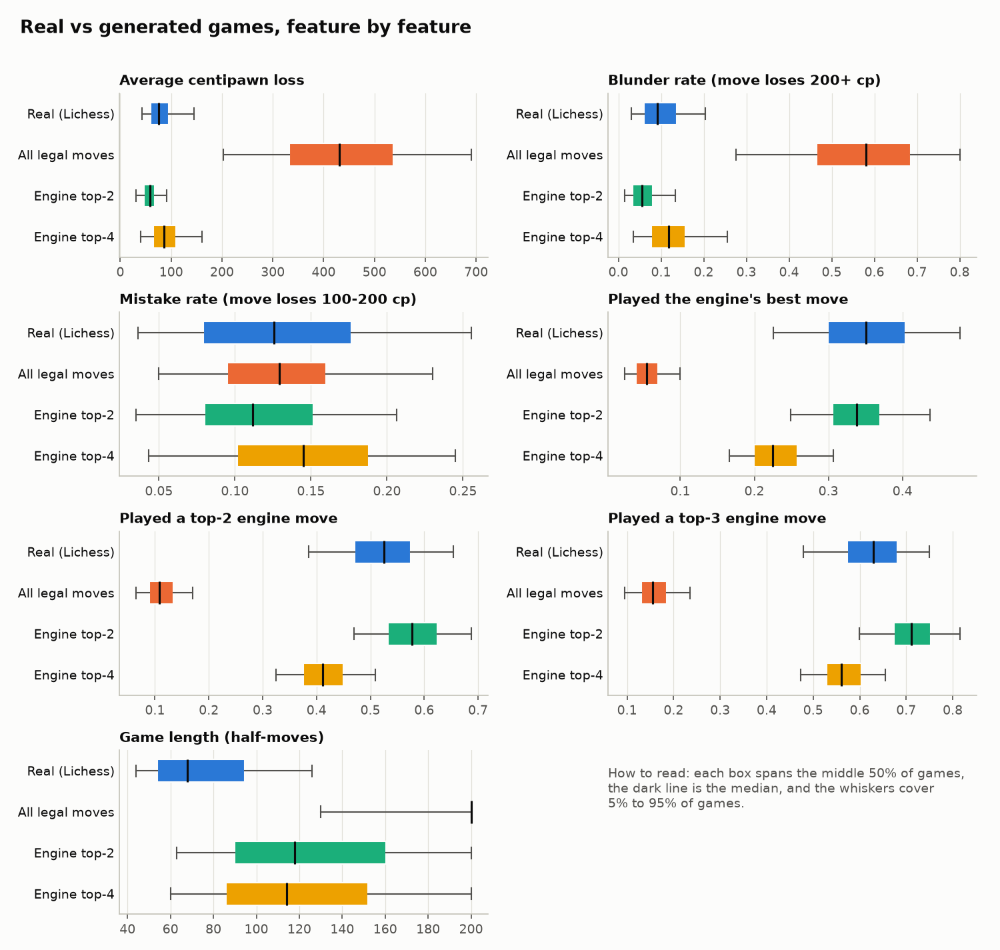
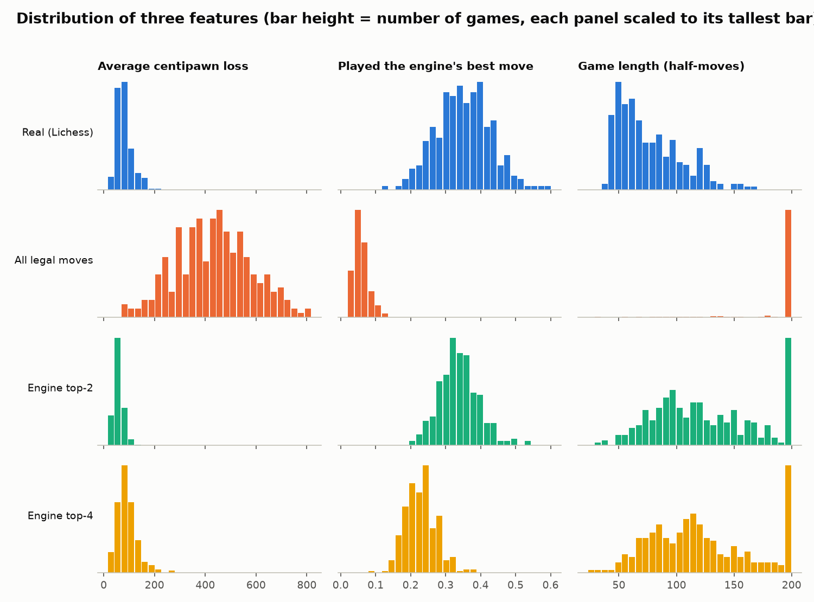
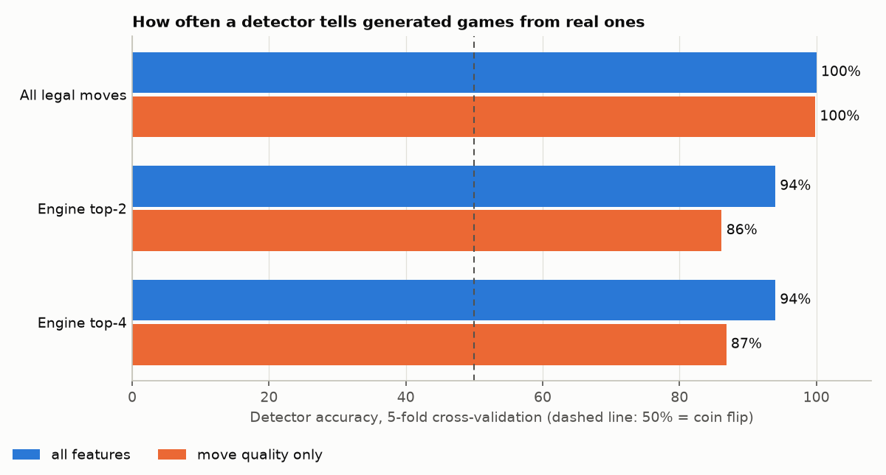

# Stage 3 results: can a detector tell our games from real ones?

**Short answer: yes.** Games made from all legal moves are spotted essentially
100% of the time. Engine-guided games look far more like chess, but a simple
detector still catches about 94% of them. Even when the detector is only
allowed to look at move quality, it is right about 86% of the time.

## What was compared

| Set | Games | Where they come from |
|---|---|---|
| Real (Lichess) | 300 | Random sample of rated standard games with at least 20 moves from the Lichess open database, January 2013 (bullet, blitz and classical mixed) |
| All legal moves | 300 | Stage 1 ranker, hiding random encrypted data |
| Engine top-2 | 300 | Stage 2 ranker, k = 2, Stockfish 19 at 2000 nodes |
| Engine top-4 | 300 | Stage 2 ranker, k = 4, Stockfish 19 at 2000 nodes |

Every position of every game (about 150,000 positions) was analysed with
Stockfish 19 at depth 10, and each game was boiled down to nine numbers
("features"):

- **Average centipawn loss (ACPL)** — how much worse the played move was than the
  best move, on average. 100 centipawns = one pawn. Scores are capped at +-10 pawns.
- **Blunder rate / mistake rate** — share of moves losing 200+ / 100-200 centipawns.
- **Top-1 / top-2 / top-3 rate** — how often the played move was the analysing
  engine's best move / among its best two / best three.
- **Game length** in half-moves, and **how the game ended** on the board
  (checkmate, forced draw such as stalemate, or neither).

Scripts: `make_dataset.py` -> `features.py` -> `detect.py`.

## Average feature values

| | Real (Lichess) | All legal moves | Engine top-2 | Engine top-4 |
|:--|--:|--:|--:|--:|
| Average centipawn loss | 81.1 | 434.3 | 58.5 | 91.8 |
| Blunder rate (move loses 200+ cp) | 10.1% | 56.3% | 6.1% | 12.6% |
| Mistake rate (move loses 100-200 cp) | 13.4% | 13.0% | 11.5% | 14.4% |
| Played the engine's best move | 35.1% | 5.7% | 33.9% | 23.0% |
| Played a top-2 engine move | 52.2% | 11.1% | 58.0% | 41.4% |
| Played a top-3 engine move | 62.5% | 15.9% | 71.2% | 56.5% |
| Game length (half-moves) | 76.2 | 191.4 | 125.3 | 121.5 |
| Ends in checkmate | 29.7% | 11.3% | 86.7% | 86.3% |
| Ends in a forced draw | 3.3% | 1.3% | 0.0% | 0.3% |

## Detector results

For each generated set, two classifiers were trained to answer "real or
generated?" for a single game, and scored with 5-fold cross-validation (train on
4/5 of the games, test on the unseen 1/5, repeat five times). Each test is
balanced (300 real vs 300 generated), so guessing gives 50%.

"Move quality only" drops game length and game ending and keeps the six
move-quality features.

| Generated set | Features | Model | Accuracy | ROC-AUC |
|:--|:--|:--|--:|--:|
| All legal moves | all features | logistic regression | 100.0% | 1.000 |
| All legal moves | all features | random forest | 99.8% | 1.000 |
| All legal moves | move quality only | logistic regression | 99.8% | 1.000 |
| All legal moves | move quality only | random forest | 99.8% | 1.000 |
| Engine top-2 | all features | logistic regression | 93.5% | 0.989 |
| Engine top-2 | all features | random forest | 94.0% | 0.986 |
| Engine top-2 | move quality only | logistic regression | 86.2% | 0.932 |
| Engine top-2 | move quality only | random forest | 84.7% | 0.924 |
| Engine top-4 | all features | logistic regression | 94.0% | 0.983 |
| Engine top-4 | all features | random forest | 93.7% | 0.977 |
| Engine top-4 | move quality only | logistic regression | 86.8% | 0.940 |
| Engine top-4 | move quality only | random forest | 86.5% | 0.927 |

**How to read it.** Accuracy near 50% would mean the games are
indistinguishable from real ones; near 100% means they are easy to detect.
ROC-AUC is the chance that the detector gives a random generated game a higher
"suspicion score" than a random real game (0.5 = useless, 1.0 = perfect).

## What this means, in plain language

**Stage 1 games are hopeless as a disguise.** More than half of all moves are
blunders and the average move throws away over four pawns. Nobody would mistake
them for human play, and the detector never does.

**Engine games are a big improvement, but still stand out.** On average they
are in the same range as the human sample: top-2 games are a little *more*
accurate than these players (ACPL 59 vs 81) and top-4 games a little *less*
(ACPL 92). So the expected failure, "too perfect to be human", is not what
gives them away at this engine strength. Three other things do:

1. **How the games end.** About 87% of engine games are played out to
   checkmate. Humans usually resign or lose on time first; only 30% of the real
   games end in mate. Engine games are also much longer (about 125 half-moves
   vs 76), and a visible pile of them sits exactly at the 200-ply cap.
2. **Which engine choices get played.** The encoder picks uniformly among the
   top k, so every choice is equally likely. Humans are not uniform: they find
   the best move about 35% of the time, and when they miss, they often play
   something well outside the top few. Top-4 games play the best move only 23%
   of the time; top-2 games play a top-3 move 71% of the time (humans: 63%).
3. **Every generated game has the same "skill level".** Real players range
   from beginners to experts, so real games are spread out (best-move rate
   from 23% to 48% across the middle 90% of games). Generated games cluster
   tightly around one value, because they all come from the same recipe.

Taking away the obvious tells in point 1 (length and ending) lowers detection
from about 94% to about 86%. That is better, but still far from the 50% that
would mean "indistinguishable".

## Caveats

- The detector knows exactly how the games were generated and has examples of
  them. This is the standard, pessimistic assumption in security: assume the
  opponent knows your method. A casual observer is much easier to fool.
- The real games are from one month of 2013 and mix all ratings and time
  controls. A different population (say, only strong players) would shift the
  numbers.
- These are per-game results. Hiding a file takes many games, and an observer
  who sees all of them together can be even more confident.
- 300 games per set, analysed at a shallow depth 10: the percentages are good
  to within a few points, not to the decimal.
